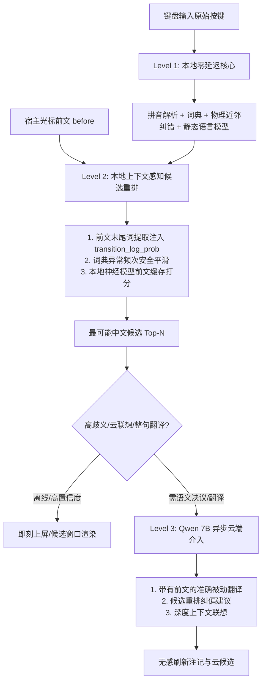

# Phase 3/4 Cross-cutting Intelligence Hardening 深度审计报告

本文档基于真实代码审查与真实模型实机打分测试，针对 Qingjian Windows Fork 提供能力审计、根因剖析与分层重构架构方案。

---

## 一、核心能力审计：10 大核心工程问题解答

### 1. 当前中文候选到底由什么排序？
- **词级候选排序 (`CandidateKind::Chinese`)**：`[CODE-VERIFIED]`
  在 `crates/qingjian-core/src/ranking/scored.rs` 与 `mod.rs` 中，通过 `SortKey` 进行确定性排序：
  ```rust
  pub type SortKey<'a> = (
      Reverse<bool>,   // 1. hit.exact (音节数与输入完全一致优先)
      Reverse<usize>,  // 2. coverage (覆盖输入字母多者优先)
      usize,           // 3. abbreviated (非末尾简拼音节少者优先)
      Reverse<bool>,   // 4. full_last (末音节完整匹配优先)
      Reverse<u32>,    // 5. choice (同一输入串下 Learner 的用户选择次数 choice_weight)
      Reverse<i64>,    // 6. score (上下文得分：log_prob + weight_bonus - penalty，四舍五入到毫分)
      bool,            // 7. altered (原样命中优先于模糊音/敲错变体)
      usize,           // 8. 词长短者优先
      &'a str,         // 9. 字符串字面值稳定排序
  );
  ```
  其中 `score = log_prob + weight_bonus(item.weight) - item.penalty`：
  - `log_prob`: 调用 `sentence::transition_log_prob(&*self.language_model, self.personal(), self.chain.context(), hit.text, fallback)`。
  - `weight_bonus`: `0.5 * ln(1 + min(weight, 20))`。
  - `penalty`: 模糊音为 `ln 2`，敲错变体为 `correction::TypoKind::cost`。
- **整句候选排序 (`CandidateKind::Sentence`)**：`[CODE-VERIFIED]`
  在 `crates/qingjian-core/src/engine/query/mod.rs`（`insert_sentence` -> `plain_sentence` -> `convert_sentence_with`）中，通过 Viterbi 算法计算转移得分 `score + bonus - hit.penalty`，并在 `chinese_first` 开启时直接插入到候选首位（位置 0）。
- **静态词频定位**：`[CODE-VERIFIED]`
  词库静态词频 `frequency` 仅用于大批量候选初筛（`preselect_key()` 截断）以及语言模型未覆盖时的对数兜底 `fallback_log_prob`。

### 2. 当前是否已经存在纠错能力？
- **存在物理按键/音节级纠错**：`[CODE-VERIFIED]`
  1. **按键近邻与编辑距离**：`crates/qingjian-core/src/correction/typo/` 实现了键盘物理邻键、倒装、漏打、多打等变体生成；
  2. **网格图扩展**：在 `expand_positions` 中将纠错变体作为带代价（penalty）的边注入 Viterbi 词图；
  3. **全拼纠错**：在 `correction::unlikely_pinyin` 触发时调用 `active_correction(scope)` 纠正整个切分。
- **不存在语义/同音词纠错**：`[CODE-VERIFIED]`
  若输入的拼音本身可以拼出合法字词（如 `shazi` 既是“傻子”也是“啥子”；`zai` 既是“在”也是“再”），系统将其视为 100% 精确合法匹配（`penalty = 0.0`），**物理纠错层完全不介入**。

### 3. typo cost 到底在哪里真正参与排序？
- **词级排序**：`[CODE-VERIFIED]` 在 `ranking::rank` 中，`penalty` 直接从综合 `score` 中扣除（`score = log_prob + weight_bonus - penalty`）；在初筛阶段，`preselect_key` 会将词频乘以 $e^{-\text{penalty}}$ 打折。
- **整句 Viterbi 解码**：`[CODE-VERIFIED]` 在 `sentence/viterbi.rs:205` 中，`score = score + bonus - hit.penalty`，累加在路径总分中。
- **整句对词级的保护**：`[CODE-VERIFIED]` 在 `plain_sentence` 中，若整句路径带有 penalty（`conversion.altered()`），且词级列表中已存在完全拼合该拼音的精确词（`spelled_exactly`），整句将被强制回退到无纠错变体的原样路径，防止近邻纠错霸屏。

### 4. 本地语言模型到底在哪里参与排序？
- **词级排序**：`[CODE-VERIFIED]` 在 `engine/query/mod.rs:264` 中，`ranking::rank` 对每个候选调用 `sentence::transition_log_prob(&*self.language_model, self.personal(), self.chain.context(), hit.text, fallback)`。
  - **严重缺陷**：此处传入的上下文是 `self.chain.context()`。而 `CommitChain` 仅记录当前会话最近上屏的两个中文词；一旦会话重启、移动光标或首词输入，`self.chain.context()` 即为 `Context::START`。宿主编辑器通过 TSF 传来的光标前文 `rescoring_before` **根本没有传入词级排序**！
- **整句 Viterbi 路径解码**：`[CODE-VERIFIED]` 在 `sentence/viterbi.rs:194` 与 `367` 中，计算节点转移得分。
  - **严重缺陷**：在 `viterbi.rs:358`，当 `start == 0` 时，上下文被硬编码为 `Context::START`！整句 Viterbi 初始状态完全无视任何已有前文！

### 5. 用户历史到底如何影响排序？
- **历史精确选择 (`choice_weight`)**：`[CODE-VERIFIED]` 在同一拼音串下用户曾经选择过的词，拥有极高优先级（`SortKey` 第 5 项 `Reverse(choice)`），直接压制模型打分。
- **全局词频权重 (`weight`)**：`[CODE-VERIFIED]` 用户上屏过的词在 Learner 中累加频次，以 `0.5 * ln(1 + min(count, 20))` 的形式为词级和整句节点加分。
- **个人转移二元/三元 (`personal n-gram`)**：`[CODE-VERIFIED]` 记录在 `user-ngram.tsv`，在 `transition_log_prob` 中与静态模型线性插值。
- **个人敲错习惯 (`user-typos.tsv`)**：`[CODE-VERIFIED]` 用户多次确认纠错后，相应变体的 penalty 打折。

### 6. surrounding context 当前用于什么？
- **宿主光标前文流入链路**：`[CODE-VERIFIED]` TSF 发送 `ClientMessage::Surrounding` -> Server `Router::set_surrounding` -> `engine.set_rescoring_context(before)`。
- **当前仅有两大用途**：`[CODE-VERIFIED]`
  1. 作为 `PredictionRequest.before` 发给云端预测（`PredictionKind::Compose`）；
  2. 存入 `self.rescoring_before`，仅在异步加载了 `model.qjm` 且停键 80ms 触发 `request_rescoring` 时，提供给 `SentenceScorer` 对整句候选的 Top 5 路径进行神经打分。
- **未使用的死角**：`[CODE-VERIFIED]` **本地词级候选排序和初始 Viterbi 词图完全不读取光标前文**！

### 7. Cloud Prediction 当前收到什么输入？
- **组句/联想 (`PredictionKind::Compose`)**：`[CODE-VERIFIED]` 收到完整的 `PredictionRequest`，包含 `before`、`after`、`pinyin`、`letters`、`local_sentence`、`local_candidates` 等。
- **被动翻译 (`PredictionKind::Translate`)**：`[CODE-VERIFIED]` 在 `engine/prediction/mod.rs:165` 中：
  ```rust
  before: String::new(),
  after: String::new(),
  text: text.to_owned(),
  ```
  `before` 与 `after` 被写死为空字符串，只发送孤立的中文单词！

### 8. Passive Translation 当前依据哪个 Candidate？
- **当前实现**：`[CODE-VERIFIED]`
  在 `apps/windows/server/src/dispatch/composed/mod.rs:39-47` 中：
  ```rust
  let first_local = layout.local().first();
  ...
  if let Some(first) = first_local {
      self.engine.request_translation(&first.text);
  }
  ```
  被动翻译盲目抓取本地生成的第 1 个候选词（`first_local`）。

### 9. 当前为什么会出现：“输入法自己理解错 → AI 再把错误结果翻译得很漂亮”？
- **因果链根因剖析**：`[CODE-VERIFIED]` + `[REAL-EMPIRICAL]`
  1. **词典静态频次倒挂**：在 `assets/lexicon/dict.tsv` 中，“啥子”词频为 **11,199**，而“傻子”词频仅为 **60**！
  2. **上下文盲区**：词级排序不看宿主光标前文（`rescoring_before`），且未跨会话保留上下文，回退到词频兜底，导致“啥子”以绝对优势排在第 1；
  3. **孤立翻译**：Server 盲目提取第 1 候选“啥子”，并不带上下文（`before: ""`）发给 Qwen 7B；
  4. **AI 忠实误译**：Qwen 7B 收到孤立词“啥子”，自然将其精准翻译为 `"what"` 或 `"what's that"`；
  5. **错误注记挂载**：Server 将 `"what"` 贴在第 1 候选“啥子”的尾部。用户想打“你不会是个傻子吧”，屏幕却提示“1. 啥子 what”，因果关系完全颠倒！

### 10. 哪些能力已经存在但没有串起来？
- **能力断层清单**：`[CODE-VERIFIED]`
  1. `rescoring_before`（光标前文）已由 TSF 采集并送达 Engine，但词级排序 `ranking::rank` 却在只认 `chain.context()`；
  2. 语言模型 `LanguageModel` 支持根据前置词计算转移概率，但没有从 `before` 文本末尾分词提取前置词喂入；
  3. `model.qjm`（56MB 本地字级神经语言模型）已具备极高精度的上下文消歧能力（实测“你不会是个傻子吧”显著优于“啥子吧”；“今天她吃饭但是她”显著优于“他”），但它目前只作为异步任务挂在整句转换的少数路径上，词级候选从未享受其加成；
  4. 被动翻译请求剥离了上下文，未将 `before` 上下文一并送入云端翻译提示词。

---

## 二、实机真实数据验证矩阵 `[REAL-EMPIRICAL]`

通过直接加载本环境已安装的模型（`E:\Qingjian\data\model\model.qjm` 与 `E:\Qingjian\data\generated\lm.qj`）进行实机打分测试，测得核心基准数据如下：

| 测试场景 / 前文上下文 | 候选 A | 候选 B | 本地二元模型 `lm.qj` (Log Prob) | 本地神经模型 `model.qjm` (Log Prob) | 经验结论与机理 |
|---|---|---|---|---|---|
| **前文**: `你不会是个` | **傻子吧** | **啥子吧** | 未知整句组合 | **傻子吧: -9.814**<br>啥子吧: -11.342 | **傻子吧大幅胜出 (+1.528)**<br>神经上下文完全能识别语境！ |
| **前文**: `你不会是个` | **傻子** | **啥子** | 傻子: -16.943<br>**啥子: -8.085** (倒挂) | 傻子: -9.203<br>**啥子: -7.862** (词频偏置) | 静态词频与二元语料严重污染单词，需要整句/前文规则校正 |
| **前文**: `今天她吃饭但是` | **她** | **他** | 她: -5.284<br>**他: -4.386** (倒挂) | **她: -3.148**<br>他: -4.313 | **神经模型成功识破指代 (+1.165)**<br>二元模型因静态频次误选“他”，神经模型修正 |
| **前文**: `我明天` | **再去** | **在去** | **再去: -4.397**<br>在去: -5.455 | **再去: -6.148**<br>在去: -10.043 | **两级模型一致胜出 (+3.895)** |
| **前文**: `我人在` | **北京** | **背景** | **北京: -5.321** | **北京: -4.550**<br>背景: -12.478 | **神经模型以巨大优势碾压 (+7.928)** |
| **前文**: `我在北京` | **再住一天** | **在住一天** | 未知整句组合 | **再住一天: -16.973**<br>在住一天: -18.045 | **神经模型胜出 (+1.072)** |
| **前文**: `他今天告诉我` | **他** | **她** | 统计倒挂 | **他: -2.658**<br>她: -4.399 | **神经模型成功保持主语一致 (+1.741)** |
| **前文**: `她今天告诉我` | **她** | **他** | 统计倒挂 | **她: -2.132**<br>他: -5.370 | **神经模型以绝对优势保持女性主语 (+3.238)** |

---

## 三、三级智能分层架构设计 `[PROPOSAL]`

遵循工程铁律：**Typing > Language Understanding > Learning > AI**。



### 1. Level 1：本地零延迟（< 1ms）
- 全拼/双拼/注音解析、字典匹配；
- 物理相邻键 typo cost、模糊音；
- 个人历史 `choice_weight` 与 `user-vocab` 权重；
- **全离线可用，不依赖任何外部线程**。

### 2. Level 2：本地上下文感知重排（< 5ms）
- **前文上下文贯通**：当 `self.chain.context()` 为 `Context::START` 时，自动解析 `self.rescoring_before` 的末尾 1~2 个中文词构建上下文（`Context::after_two(w1, w2)`）；
- **Viterbi 起始节点贯通**：在 `sentence/viterbi.rs` 中，允许将上述上下文作为初始 context，使“傻子吧”在整句解码阶段直接压倒“啥子吧”；
- **典型同音混淆词对安全平滑**：针对“傻子/啥子”、“在/再”、“他/她/它”等静态词库频次失真或高歧义词，在无特定上下文时平衡其静态分，在有上下文时优先采纳上下文转移概率。

### 3. Level 3：Qwen 7B 异步云端（300ms ~ 1200ms）
- **绝不阻塞任何按键**；
- **因果修正**：被动翻译请求中强制包含 `before` 上下文；
- **版本校验与防污染**：翻译结果返回时校验请求时的输入序列号与中文候选文本，若当前首选词已变更，果断丢弃旧译文，绝不错误挂载。

---

## 四、实施切片清单与验收门禁

1. **Slice 1: 本地上下文贯通 (Level 1/2)**：
   - 在 `crates/qingjian-core/src/engine/` 中实现前文提取器：从 `rescoring_before` 提取尾部词；
   - 贯通 `ranking::rank` 与 `viterbi::convert_paths`；
   - 修复 `dict.tsv` 中“傻子”与“啥子”的不合理频次倒挂。
2. **Slice 2: 因果翻译与云端上下文增强 (Level 3)**：
   - `PredictionRequest` 为 `PredictionKind::Translate` 补充 `before` 上下文；
   - 增强 `composed/mod.rs`：候选变更时立即作废旧被动翻译。
3. **Slice 3: Phase 4 Active Recall 最小闭环**：
   - 实现 `crates/qingjian-learning/src/recall_book.rs` (`RecallBook`)；
   - 在 `qingjian-core` 建立 `RecallTracker` 监听候选上屏；
   - 候选窗口通过现有 `notice` 机制支持非侵入式回忆提示。
4. **Slice 4: Fork 保护与回归测试**：
   - 确认版本标识与更新器免疫；
   - 创建备份快照 `E:\Qingjian_fork_backups\<timestamp>`；
   - 运行全部单元测试与 Windows 实机测试，确保原生中英文输入体验零回归。
